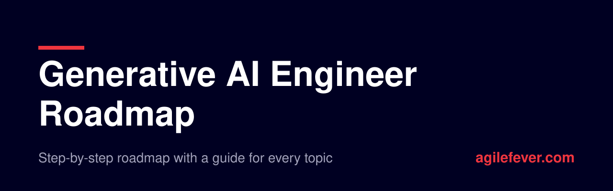

# Generative AI Engineer Roadmap

> A step-by-step roadmap to become a Generative AI Engineer: from Python and LLM foundations to prompts, RAG, fine-tuning, and deployed apps

## Table of Contents

- [Who is a Generative AI Engineer?](#who-is-a-generative-ai-engineer)
- [What makes this roadmap different](#what-makes-this-roadmap-different)
- [The GenAI Learning Path](#the-genai-learning-path)
- [How to Use This Roadmap](#how-to-use-this-roadmap)
- [Step 0: Must Know](#step-0-must-know)
- [Step 1: Python for GenAI](#step-1-python-for-genai)
- [Step 2: Deep Learning and NLP Basics](#step-2-deep-learning-and-nlp-basics)
- [Step 3: Generative AI Foundations](#step-3-generative-ai-foundations)
- [Step 4: Prompt Engineering](#step-4-prompt-engineering)
- [Step 5: LLMs in Depth](#step-5-llms-in-depth)
- [Step 6: Retrieval-Augmented Generation (RAG)](#step-6-retrieval-augmented-generation-rag)
- [Step 7: Fine-Tuning LLMs](#step-7-fine-tuning-llms)
- [Step 8: Multimodal and Image Generation](#step-8-multimodal-and-image-generation)
- [Step 9: GenAI for Code and Productivity](#step-9-genai-for-code-and-productivity)
- [Step 10: Deployment and LLMOps](#step-10-deployment-and-llmops)
- [Step 11: Ethics, Bias, and Safety](#step-11-ethics-bias-and-safety)
- [Step 12: Capstone and Portfolio](#step-12-capstone-and-portfolio)
- [Step 13: Prepare for GenAI Interviews and Certification](#step-13-prepare-for-genai-interviews-and-certification)
- [Learn This Roadmap with a Mentor](#learn-this-roadmap-with-a-mentor)
- [License](#license)

### Prepared and maintained by [AgileFever](https://agilefever.com)

### Follow AgileFever

- [LinkedIn](https://www.linkedin.com/company/agilefever/)
- [YouTube](https://www.youtube.com/@AgileFever)
- [X/Twitter](https://x.com/agilefever)
- [Website](https://agilefever.com)

## Learn with AgileFever

- [Gen AI BootCamp](https://agilefever.com/bootcamps/gen-ai-bootcamp/)

---

> **Note: We keep updating this roadmap with new topics and blogs.**

---

### Who is a Generative AI Engineer?

A Generative AI Engineer builds applications on top of large language models and other generative models, for tasks such as writing, summarising, search, content creation, and automation.

The work covers understanding how the models behave, shaping their output with prompts, retrieval, and fine-tuning, and turning the result into an app other people can use.

### What makes this roadmap different

This roadmap goes from the ground up. It starts with Python and a short pass through deep learning, then moves through how generative models and LLMs work, and ends with working, deployed applications. Agents and customer deployments are covered in the other AgileFever roadmaps.

### The GenAI Learning Path

| Stage | What you learn | Steps |
| --- | --- | --- |
| Orient | The field and its vocabulary | Step 0 |
| Foundations | Python, deep learning, NLP, generative models | Step 1 to Step 3 |
| Use models well | Prompts, LLMs, RAG, fine-tuning | Step 4 to Step 7 |
| Go beyond text | Images, video, code, productivity | Step 8, Step 9 |
| Ship safely | Deployment, LLMOps, ethics | Step 10, Step 11 |
| Prove it | Capstone and interviews | Step 12, Step 13 |

### How to Use This Roadmap

This roadmap can be followed in the given order by anyone who can write basic code.

- Follow the steps in order. Each step builds on the previous one.
- Inside each step, read the blogs in the given order. Each blog explains one idea in plain words.
- Topics without a link are covered in the course. Use the official documentation of the tool while you practise them.
- After every step, ask yourself: "Could I explain this to a teammate and build a small example of it?" If yes, move on.
- Build something small at the end of each step. Reading alone does not make an engineer.

Let's get started.

### Step 0: Must Know

Generative AI creates new text, images, and code from a prompt. Before the details, get a plain picture of what the field covers and what a GenAI engineer builds.

- [Generative AI courses in 2026: where to start](https://agilefever.com/generative-ai-courses/)
- [Generative AI skills you will build](https://agilefever.com/generative-ai-skills-gen-ai-bootcamp/)
- [Generative learning vs discriminative learning](https://agilefever.com/generative-learning-vs-discriminative-learning/)
- [Large Language Models: a complete guide](https://agilefever.com/large-language-models-llm-guide/)
- [Top AI tools across industries in 2026](https://agilefever.com/ai-tools/)
- [Artificial intelligence terms from A to Z](https://agilefever.com/artificial-intelligence-terms-ai-glossary-examples/)

**Checkpoint:** Describe in one paragraph what generative AI can and cannot do.

### Step 1: Python for GenAI

Almost every GenAI tool has a Python API. We need functions, loops, data handling, and the common libraries before we call a model.

- [Python for AI roadmap: NumPy, Pandas, PyTorch](https://agilefever.com/python-for-ai-roadmap/)
- [Python for AI: the free starter course](https://agilefever.com/python-for-ai-free-course-who-should-take-it/)
- Functions, loops, and conditionals
- NumPy and Pandas
- JSON, APIs, and data handling
- Mini project: a chatbot or a data parsing tool

**Checkpoint:** Write a Python script that reads JSON and calls an API.

### Step 2: Deep Learning and NLP Basics

LLMs are neural networks trained on text. A short pass through deep learning and NLP makes the rest of the roadmap far easier to follow.

- [Machine learning and deep learning from foundations](https://agilefever.com/machine-learning-deep-learning-guide/)
- Neural networks, ANN, CNN, RNN, and LSTM
- [Do you need calculus for linear algebra?](https://agilefever.com/do-you-need-calculus-for-linear-algebra/)
- [CUDA in deep learning explained](https://agilefever.com/cuda-in-deep-learning/)
- Text cleaning and word embeddings
- Sentiment analysis

**Checkpoint:** Explain what a neural network learns and what an embedding is.

### Step 3: Generative AI Foundations

This step covers the main families of generative models and the architectures behind them, so we can say which one fits a given task.

- History and evolution of generative AI
- Large language models, diffusion models, GANs, and autoencoders
- Transformers: encoder, decoder, and encoder-decoder
- [Generative learning vs discriminative learning](https://agilefever.com/generative-learning-vs-discriminative-learning/)
- [Agentic AI vs Generative AI](https://agilefever.com/agentic-ai-vs-generative-ai/)
- Project: generate images with GANs and diffusion models

**Checkpoint:** Say how a transformer differs from a GAN and a diffusion model.

### Step 4: Prompt Engineering

Prompts are the first and cheapest control we have over a model. We learn the standard patterns and how to test a prompt instead of guessing.

- Zero-shot and few-shot prompts
- Chain-of-thought and tree-of-thought prompting
- Prompt templates and optimization
- [Prompt engineering vs context engineering](https://agilefever.com/prompt-engineering-vs-context-engineering/)
- Function calling and guardrails
- Prompt testing and evaluation
- Project: build a QA system and summaries with chain-of-thought

**Checkpoint:** Improve one prompt and show that the new version is better.

### Step 5: LLMs in Depth

Here we look inside the model: how text becomes tokens, what attention does, and how the major models differ. Then we use the APIs.

- Tokenisation
- Attention and positional embeddings
- GPT, LLaMA, Claude, and Gemini compared
- [Comparing ChatGPT, Gemini, Claude, and others](https://agilefever.com/chatgpt-vs-grok-vs-gemini-vs-claude-vs-perplexity/)
- OpenAI, Gemini, and Claude APIs in practice
- Choosing an LLM for a task
- [Source code to build your first AI assistant](https://agilefever.com/source-codes-build-ai-assistant-with-generative-ai/)

**Checkpoint:** Explain tokens and attention to a friend, then call two different model APIs.

### Step 6: Retrieval-Augmented Generation (RAG)

A model only knows what it was trained on. RAG lets it answer from your own documents, and it is the most common pattern in real GenAI apps.

- Embeddings and similarity search
- Vector databases: FAISS, Pinecone, Weaviate
- [RAG pipelines with LangChain and LlamaIndex](https://agilefever.com/build-production-ready-llm-langchain-framework/)
- Chunking strategies
- Hybrid search and query rewriting
- [How to evaluate an LLM application](https://agilefever.com/evaluate-llm-application/)
- Project: a knowledge-based RAG chatbot

**Checkpoint:** Build a chatbot that answers from a folder of documents.

### Step 7: Fine-Tuning LLMs

Sometimes prompts and retrieval are not enough. We learn when to fine-tune, how to prepare data, and how to adapt a model without retraining all of it.

- Fine-tuning vs RAG: when each fits
- LoRA, QLoRA, and PEFT
- Training data preparation
- Fine-tuning on Hugging Face
- Quantization
- Evaluating the fine-tuned model
- Project: classify support tickets with an open-source model

**Checkpoint:** Say when you would fine-tune instead of using RAG.

### Step 8: Multimodal and Image Generation

Models now read and produce images, video, and documents. We cover text-to-image tools and how to control them.

- Text-to-image: DALL-E, Midjourney, and Stable Diffusion
- Text-to-video overview
- Image prompting and ControlNet basics
- Vision-language models
- OCR and PDF extraction
- Project: create art and video from prompts

**Checkpoint:** Generate an image with a prompt and change it with a second prompt.

### Step 9: GenAI for Code and Productivity

GenAI also changes how engineers work. We use it to write code, summarise documents, and automate repeated tasks, and we learn where to be careful.

- [AI tools for software teams](https://agilefever.com/ai-tools-for-software-teams/)
- [Vibe code vs real code](https://agilefever.com/vibe-code-vs-real-code/)
- [Generative AI in DevOps: eight pipeline tasks](https://agilefever.com/generative-ai-in-devops/)
- GitHub Copilot and CodeWhisperer
- Document summarization, form filling, and report generation
- Project: auto-generate code, reports, or documentation

**Checkpoint:** Use an AI coding tool on a real task and review its output line by line.

### Step 10: Deployment and LLMOps

A notebook is not an app. We wrap the model in an interface, package it, and learn how teams run GenAI apps over time.

- [LangChain orchestration](https://agilefever.com/build-production-ready-llm-langchain-framework/)
- Streamlit and Gradio
- Docker containers
- Hugging Face Spaces and local deployment
- Model versioning
- [LLMOps vs MLOps](https://agilefever.com/llmops-vs-mlops/)
- [Build fast apps with AI](https://agilefever.com/build-fast-apps-with-ai/)

**Checkpoint:** Put an app on the web with a public link.

### Step 11: Ethics, Bias, and Safety

GenAI can be wrong, biased, or tricked. We learn to reduce these risks and to build the checks into the app.

- [Prompt injection and guardrails](https://agilefever.com/prompt-injection-guardrails/)
- Hallucination control
- Bias mitigation and explainability
- Copyright, intellectual property, and ethical guidelines
- Moderation filters for safe outputs
- [Building successful AI products on robust architecture](https://agilefever.com/building-successful-ai-products-with-robust-architecture/)

**Checkpoint:** Test your app with a hostile prompt and fix what you find.

### Step 12: Capstone and Portfolio

The last build is a live GenAI app with retrieval and reasoning. A finished, deployed project is the strongest thing you can show.

- Choosing a capstone from real-world use cases
- Building the app end to end: retrieval, reasoning, interface
- Deploying it with a public link
- Writing a README and architecture notes
- [Gen AI BootCamp: the ultimate guide](https://agilefever.com/gen-ai-bootcamp-guide/)
- [Gen AI BootCamp curriculum, module by module](https://agilefever.com/gen-ai-bootcamp-curriculum-breakdown/)

**Checkpoint:** Publish your capstone with a README and a short demo.

### Step 13: Prepare for GenAI Interviews and Certification

Interviews usually ask you to explain how an LLM works, design a RAG app, and talk through trade-offs. We also look at which credentials exist and what they prove.

- [LLM certification: which credentials exist and what they prove](https://agilefever.com/llm-certification/)
- [Best LLM courses: a syllabus checklist](https://agilefever.com/best-llm-courses/)
- [LLM training courses: how to choose](https://agilefever.com/llm-training-courses/)
- [Free LLM courses: a path from zero to a working project](https://agilefever.com/free-llm-courses-2026/)
- [AI learning plan for working professionals](https://agilefever.com/ai-learning-plan-for-working-professionals/)
- [Gen AI BootCamp vs GenAI and Agentic AI BootCamp](https://agilefever.com/gen-ai-bootcamp-vs-genai-and-agentic-ai-bootcamp/)

**Checkpoint:** Explain your capstone design choices in an interview-style walkthrough.

Interviews usually test three things:

- **Explaining the basics:** tokens, attention, transformers, and prompts. Steps 3 to 5.
- **Designing an app:** RAG, fine-tuning, or prompting for a given case. Steps 4, 6, and 7.
- **Shipping and safety:** deployment, evaluation, and risk. Steps 10 and 11.

### Learn This Roadmap with a Mentor

The [Gen AI BootCamp](https://agilefever.com/bootcamps/gen-ai-bootcamp/) covers this path in live sessions, with hands-on projects and a capstone you choose from real-world use cases. It is a good fit if you want guided practice and feedback instead of working alone.

### License

This roadmap is licensed under CC BY 4.0. You may share and adapt it with credit to AgileFever.
